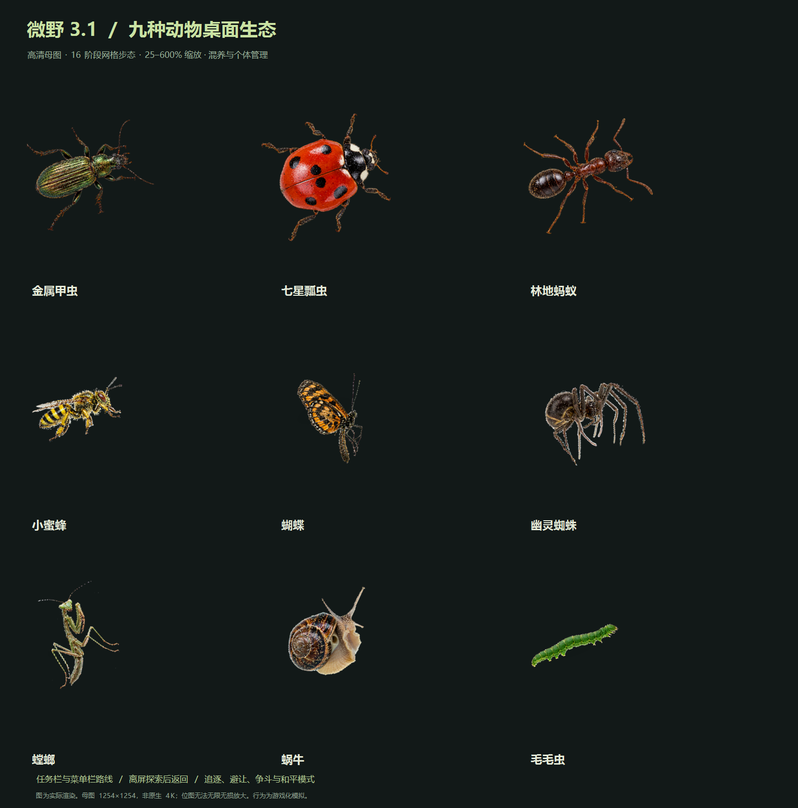

# 微野 · DesktopCritters

**Nine little lives that move around your Windows desktop.** — 九种会爬、会飞、会搬家的小动物，住在你的 Windows 桌面上。

[](LICENSE)
[](https://github.com/USERNAME/DesktopCritters)
[](https://dotnet.microsoft.com/download/dotnet-framework/net48)
[](https://github.com/USERNAME/DesktopCritters/releases)
[](https://github.com/USERNAME/DesktopCritters/releases)



## What is this?

微野 (DesktopCritters) is a desktop-pet toy written in C# / WinForms. Small animals walk, climb, fly and carry things across your real desktop — along the taskbar, over window edges, between your icons.

Every animal is driven by a single high-resolution (1254×1254) sprite that is deformed live by a 16-phase grid mesh, so the gait keeps working from 25% to 600% zoom without any pre-baked frames.

**The ant really moves your desktop icons.** The pets read the shell's list view through documented window messages and only change the *displayed position* — no file is ever opened, read, moved or deleted, and one click in the tray restores everything.

## Features

- **Nine species** — beetle, ladybug, ant, bee, butterfly, spider, mantis, snail and caterpillar. Each has its own speed, temperament and signature move.
- **Every animal, every trick** — all of them can haul a desktop icon to a new spot, take to the air (winged ones flap, the others leap or balloon on silk) and nudge food piles around.
- **Real desktop awareness** — pets climb the taskbar and menu bars, ride window edges, follow the window they stand on when it moves, and hide behind windows that cover them.
- **Icon housekeeping** — an animal picks a desktop icon, walks it dozens to hundreds of pixels away and puts it down; the tray menu restores every moved icon in one click. (Disabled automatically when the shell refuses, e.g. auto-arrange icons.)
- **Living behaviours** — hungry, tired, trust; eating, sleeping, sniffing, looking around, shivering, sunbathing, playing dead, staring; following companions, chasing, dodging and playful (harmless) spats with a peace mode.
- **Per-pet management** — name, body size (50–200%), temperament, preferred route; add or remove any species at any time.
- **Wheel zoom** — hover the mouse wheel over any pet to resize it on the spot, no matter which window is in front.
- **Off-screen trips** — pets crawl past the screen edge, explore outside for a few seconds and come back; "recall all" brings everyone home.
- **Quiet by design** — no network, no telemetry, no keyboard logging, no screenshots. Idle pets stop re-rendering.
- **Themes** — light and dark UI, six-page manager, tray hotkeys (Ctrl+Alt+P/O/F/H/M).

## Download

Grab the latest build from the [Releases page](https://github.com/USERNAME/DesktopCritters/releases):

| File | What it is |
|---|---|
| `DesktopCritters-<version>-portable.exe` | single-file build — just run it |
| `DesktopCritters-<version>-setup.exe` | per-user installer with shortcuts |

Requirements: Windows 10/11, .NET Framework 4.8 (preinstalled on modern Windows).

## Build from source

```powershell
# from the repository root
powershell -ExecutionPolicy Bypass -File build.ps1
```

The script compiles `DesktopCritters.exe` (single-file portable) and `DesktopCritters-Setup.exe` (installer) into `dist/` using the .NET Framework 4.x C# compiler that ships with Windows. No NuGet packages, no SDK required.

Open `DesktopCritters.csproj` in Visual Studio if you prefer an IDE build.

### Adding a species

1. Draw the animal on a 1254×1254 transparent canvas (subject ≤ 78% of the width, centred) and save it as `Assets/<Id>-HD.png`.
2. Register it in `CreatureCatalog.cs` — one line, done. Movement, feeding, carrying, flight and surface traversal are shared by all species.
3. Optionally extend `PetForm.Chores.cs` for a signature behaviour.

## Usage

- **Left click** a pet to startle it, **hold and drag** to pick it up.
- **Mouse wheel** over a pet zooms that pet between 50% and 200%.
- **Right click** a pet for routes, chores and removal.
- Tray icon: manager, pause, hide, recall, peaceful mode, feed, restore icons, about.
- Hotkeys: `Ctrl+Alt+P` hide/show · `Ctrl+Alt+O` manager · `Ctrl+Alt+F` feed at cursor · `Ctrl+Alt+H` recall all · `Ctrl+Alt+M` peaceful mode.

## Privacy & safety

- Icon moving uses the documented `SysListView32` shell interface and only changes **display positions**; no file content is ever read and nothing is injected into other processes.
- No network requests, no screenshot recognition, no keyboard recording.
- If the desktop has "auto-arrange icons" enabled the shell rejects manual placement; the animals simply give up.

## License

[MIT](LICENSE) © DesktopCritters contributors. Artwork (HD sprites, logo and icon) is included under the same license.

---

# 中文说明

**微野** 是一个用 C# / WinForms 写的 Windows 桌面宠物小程序。九种小动物——金属甲虫、七星瓢虫、林地蚂蚁、小蜜蜂、蝴蝶、幽灵蜘蛛、螳螂、蜗牛、毛毛虫——会在你的真实桌面上行走、攀爬任务栏、飞一小段，并把桌面图标搬到别的地方。

每个物种由一张 1254×1254 的高清透明母图驱动，运行时通过 16 阶段网格形变实时扭曲，25%–600% 缩放都有对应步态，不需要预烘焙动画帧。

**蚂蚁（以及所有动物）搬运图标是真实的**：程序通过桌面外壳的列表视图接口只改变图标的显示位置，不打开、不读取、不改动任何文件内容，托盘一键还原。

## 功能一览

- 九种动物，速度、性格、招牌动作各不相同
- 所有动物都能搬图标、腾空飞一段（会飞的振翅，不会飞的蹦跳/喷丝乘风）、推食物
- 任务栏/菜单栏/窗口边缘攀爬，站在窗口上随窗口移动，被遮挡时会隐藏
- 饥饿、精力、信任；进食、睡觉、嗅探、张望、抖动、晒太阳、装死、凝视
- 结伴、追逐、避让与无伤害争斗；和平模式
- 个体管理：改名、体型（50%–200%）、性格、路线，随时增删
- 滚轮悬停任意动物即时放大缩小
- 离屏外出与一键召回；深浅双主题；托盘快捷键
- 不联网、无广告、不记录键盘、不截图识别

## 下载

到 [Releases 页面](https://github.com/USERNAME/DesktopCritters/releases) 下载：

- `DesktopCritters-<version>-portable.exe` —— 单文件便携版，直接运行
- `DesktopCritters-<version>-setup.exe` —— 当前用户安装版

需要 Windows 10/11 与 .NET Framework 4.8（新系统自带）。

## 自行编译

```powershell
powershell -ExecutionPolicy Bypass -File build.ps1
```

使用 Windows 自带的 .NET Framework 编译器，无需 SDK、无需 NuGet。也可直接用 Visual Studio 打开 `DesktopCritters.csproj`。

## 联系方式

- 微信公众号：景同志
- 小红书：景同学
- 软件「关于」窗口内也有以上入口与 GitHub 地址

## 许可证

[MIT](LICENSE)
